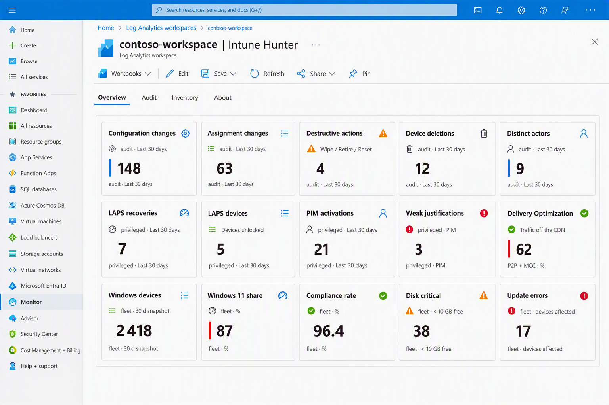
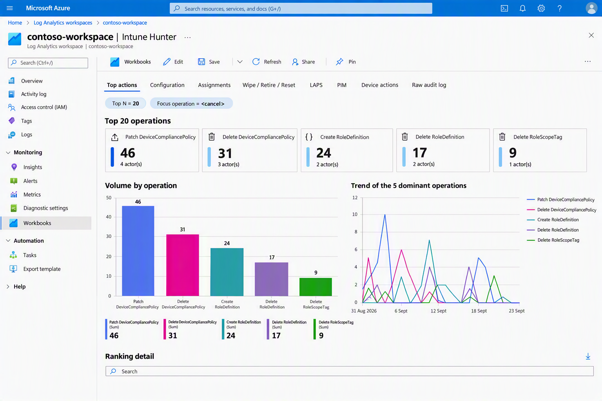

# Intune Hunter Workbook

*A personal side project to make a handful of recurring Intune/Entra ID log
questions easier to answer than writing a fresh KQL query every time.*

## Highlights

- Audit hunting across Intune configuration, assignment and destructive
  device changes, all sourced from `IntuneAuditLogs`.
- Wipe / Retire / Reset tracking with the target **device name resolved**
  even when the raw event only carries an internal object ID.
- Windows LAPS password recovery and PIM role activation tracking, both with
  harvesting / off-hours detection.
- A fleet-state inventory view: Windows versions, update errors, disk space,
  Autopilot builds, OS currency, compliance, Delivery Optimization.

## Overview

The general goal is to make it easy to answer relatively simple, recurring
questions from Intune and Entra ID logs — who changed this policy, what did
a device's enrollment look like before a given change, are Autopilot
deployments actually performing better now — without turning every one of
those questions into a fresh KQL query. See [Why this exists](docs/01-why.md)
for the field problems that started it and the full reasoning.

## What it looks like

See [Navigation](docs/04-navigation.md) for what each tab and sub-tab shows.

## Installation

1. Import [`workbook/IntuneHunter.workbook`](workbook/IntuneHunter.workbook)
   into an Azure Monitor Workbook (Advanced Editor → paste → Save).
2. Point its three resource pickers (Intune logs, Entra ID logs, Windows
   Update reports) at your own workspace(s), and save it.

Full steps in [Install](docs/03-install.md); what needs to be enabled
beforehand (diagnostic settings, licensing) is in
[Requirements](docs/02-requirements.md).

## Documentation

- [Why this exists](docs/01-why.md)
- [Requirements](docs/02-requirements.md)
- [Install](docs/03-install.md)
- [Navigation reference](docs/04-navigation.md)
- [Reading notes](docs/05-reading-notes.md)
- [Design notes](docs/06-design-notes.md)
- [Known limitations](docs/07-known-limitations.md)
- [Contributing](docs/08-contributing.md)
- [Security](docs/09-security.md)
- [Credits & sources](docs/10-credits.md)
- [Changelog](docs/11-changelog.md)

## Feedback and Contributing

Bug reports, questions and suggestions are welcome as
[issues](https://github.com/MonsieurPec/IntuneHunterWorkbook_Private/issues)
— support and response time are limited, since this
is maintained on a best-effort basis alongside everything else. Pull
requests aren't being accepted for now; see
[Contributing](docs/08-contributing.md). Found a security issue instead? See
[Security](docs/09-security.md).

## License

MIT. See [LICENSE](LICENSE).

## Authors

Conceived and directed by a human ([MonsieurPec](https://github.com/MonsieurPec)).
The audit requirements, the field problems it had to solve, and every decision
about what counted as "working" came from me. The KQL is a mix of my own queries
and community contributions, refined and optimized with Claude. The JSON structure
was designed by Claude. The documentation was drafted by hand, polished with Claude,
and double-checked by me. Despite attention to details this project might contains errors.

[Credits & sources](docs/10-credits.md).
